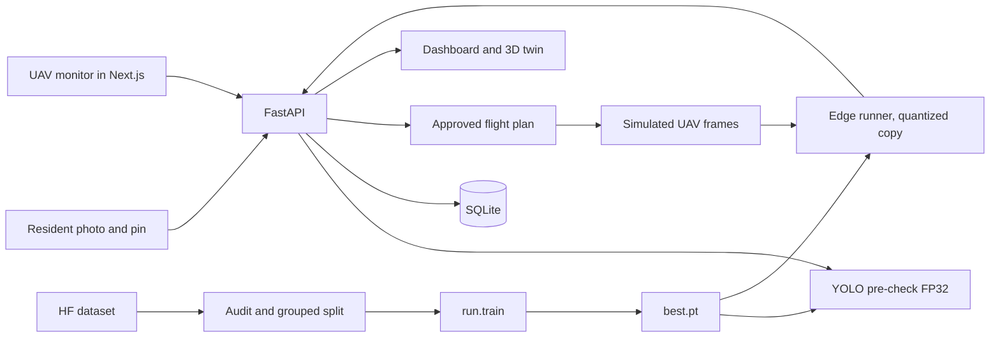

# Smart City UAV for Pothole Detection — Architecture

> Generated on 2026-11-08 | Moment: **validate** — course-project skeleton (39 stubs still raise `NotImplementedError`), no model trained yet, no production users.

## Summary

The architecture is a good fit for a three-person course project: one FastAPI monolith, one Next.js app, SQLite by default, and a config-driven ML pipeline. The risk is not over-building infrastructure. It is measuring a model on data that has not been audited. The next move is a clearly labelled YOLO26n prototype, gated by a smoke test, whose results and weights do not feed the formal model comparison.

## Alignment Score

```
Architecture Alignment — validate moment

  Current stack vs ideal for validate:

  ✅ FastAPI monolith + SQLite    — right size for a demo with no real traffic
  ✅ Next.js 15 frontend          — one app, typed API client, no extra services
  ✅ Ultralytics on local/lab GPU — no cloud cost, 12 GB RTX 3060 suits a nano model
  ✅ config.py + build.py + run/  — keeps experiments reproducible from one file
  ⚠️  MLflow registry             — required by the report (§3.5), not needed before SCRUM-28
  ⚠️  Evidently drift monitoring  — nothing to compare against until a field set exists
  ⚠️  ultralytics>=8.3            — YOLO26 needs 8.4+; floor is too low and unpinned
  ⚠️  optimizer="auto"            — ignores lr0 and changes optimizer with dataset size
  ❌ NCNN export with int8=True   — Ultralytics NCNN export lists FP32/FP16 only
  ❌ train.yml + root model.py    — Studio 7 TensorFlow demo; unrelated to the YOLO pipeline

  Alignment: 60% (6/10) — 4 ✅, 4 ⚠️ at half weight, 2 ❌; the gaps are config and pipeline correctness, not excess infrastructure
```

## Diagnosis

### Working well

- `compile_train_args` gives every candidate identical settings, which is what makes the later model comparison fair.
- Heavy imports stay inside functions, so CI can test `ml/build.py` with `.[dev]` only.
- `PROJECT_CONTEXT.md` separates confirmed facts from suspicions, including the known RDV-RDD duplicate pairs.

### Technical debt

| Item | Impact | Effort | Problem |
|---|---|---|---|
| Data audit not run (SCRUM-18) | High | High | Copies may cross the published train/val split, so val mAP may be inflated. |
| No clean images in validation | High | Medium | `stats.json` reports 0 backgrounds, so false alarms can't be measured. |
| `optimizer="auto"` | Medium | Low | Ultralytics picks AdamW at or below 10,000 iterations and MuSGD above, so a smoke run tests a different optimizer from the full run. `lr0` is ignored. |
| Unpinned Ultralytics | Medium | Low | `aistuff` has 8.4.184. A teammate installing `>=8.3` could get a version without YOLO26. |
| `export.int8=True` for Pi | Medium | Medium | Unsupported for NCNN (SCRUM-35). |
| 640 px input for aerial view | Medium | Medium | A 40 cm pothole is about 5 px wide at 30 m. Aerial recall may be limited by resolution rather than the model. |
| `train_one` does not log to MLflow | Low | Low | `mlflow_run_id` is `None` until SCRUM-19 is finished. |

### Premature complexity

| Item | Recommendation | Savings |
|---|---|---|
| Evidently (SCRUM-36) | Leave uninstalled until a field set exists. | One fewer heavy dependency during model work. |
| MLflow server for the prototype | Use Ultralytics' run folder for now. Keep MLflow for SCRUM-25. | No server to run for a single experiment. |

## Architecture Diagram (ASCII)

```
Resident photo + pin ──> FastAPI ──> YOLO pre-check (FP32) ──> SQLite
                            │
                            v
UAV monitor (Next.js) ──> approved flight plan ──> simulated UAV frames
                                                        │
                                                        v
Dashboard / 3D twin <── merged detections <── edge runner (same weights, quantized)

Training path:
HF dataset ──> audit + grouped split ──> run.train ──> best.pt ──> thresholds ──> export
```

## Architecture Diagram (Mermaid)



## Use Now

### Ultralytics 8.4.x on the local RTX 3060
- **Role:** prototype and smoke training, run in conda env `aistuff`.
- **Why now:** team of 3, free budget, and `yolo26n` fits easily in 12 GB.
- **When to replace:** move to the lab 2× RTX 4090 server when a single full run exceeds 12 hours locally, or for the 9 runs of the three-model, three-seed comparison.

### FastAPI + SQLite
- **Role:** report API and storage.
- **Why now:** demo-scale traffic with one backend process.
- **When to replace:** PostgreSQL when more than one API process writes concurrently. `DATABASE_URL` already supports it.

### Next.js 15
- **Role:** resident and monitor UI.
- **Why now:** one frontend, one typed client.
- **When to replace:** no trigger within the course timeline.

### Ultralytics run folder for experiment tracking
- **Role:** metrics, plots and weights for the prototype in `backend/runs/train/`.
- **Why now:** there is one experiment to track.
- **When to replace:** at SCRUM-25, when 2 or more models are compared.

## Add Later

- **MLflow tracking and registry** — add when: SCRUM-25 starts. Not now because: one prototype run doesn't need a server.
- **Clean validation images** — add when: the audit produces reviewed negatives. Not now because: they depend on tracing dropped RDD images (Stage 7 of the audit).
- **Targeted training negatives** — add when: false alarms on clean validation images exceed the team's target. Not now because: the agreed direction is to diagnose first. Cap at about 10% of training.
- **Larger `imgsz` or tiling for aerial** — add when: aerial AP is measurably below ground AP after the aerial/ground error breakdown. Not now because: it multiplies training cost before there is evidence.
- **Evidently drift reports** — add when: the field set has at least 150 clean and 150 damaged images.

## Don't Use Now

- **TamAko783 pretrained weights** — trained on images that may enter the test set. Reconsider: never for initialization; flagging images for human review only.
- **Prototype weights as a starting point for later runs** — the prototype trains on images that may land in val or test after the audit. Reconsider: never.
- **Prototype mAP in the report or SCRUM-25** — the split is unaudited. Reconsider: only after retraining on the frozen split.
- **`freeze_test_set` during prototyping** — the audit must pass first. Reconsider: after human review at audit Stage 8.
- **GitHub-hosted runners for YOLO training** — no GPU and the dataset is 7.14 GB. Reconsider: if a self-hosted GPU runner is added to the lab server.
- **Hugging Face Jobs or paid cloud GPU** — local and lab GPUs are free. Reconsider: if the lab server is unavailable for more than a week before the model decision.

## Architecture Decision Records

### ADR-001: Prototype on the published train/val split
- **Choice:** train `yolo26n` on the published 25,677/4,509 split, extracted to `backend/data/prototype/`.
- **Why:** it validates the pipeline and gives a first per-class and per-source error picture without waiting for the audit.
- **Tradeoff:** val metrics may be inflated by duplicates and aren't comparable with later results.
- **Revisit when:** the audited split is frozen. Then retrain from COCO weights.

### ADR-002: Use COCO-pretrained weights only
- **Choice:** initialize from `yolo26n.pt` (COCO).
- **Why:** team rule in PROJECT_CONTEXT §8; it avoids contamination from models trained on the same images.
- **Tradeoff:** possibly slower convergence than a road-damage checkpoint.
- **Revisit when:** a checkpoint exists that was trained only on images outside the frozen val and test sets.

### ADR-003: Pin the optimizer before any smoke test
- **Choice:** set `TrainConfig.optimizer` to `MuSGD` with `lr0=0.01`, the settings `auto` selects for a full run.
- **Why:** with `auto`, a 3-epoch smoke run on 5% of the data uses AdamW while a full run uses MuSGD, so the smoke test wouldn't cover the real configuration.
- **Tradeoff:** MuSGD may be poorly suited to very short runs, so smoke mAP means little. The smoke test checks that training works, not model quality.
- **Revisit when:** SCRUM-25 confirms or replaces this setting for all three candidates.

### ADR-004: Keep raw data read-only with an extracted working copy
- **Choice:** archives stay in `backend/data/raw/unified/`, extracted copy and label cache in `backend/data/prototype/`.
- **Why:** the audit handoff forbids changing raw files, and Ultralytics writes `.cache` files beside labels.
- **Tradeoff:** about 7 GB of extra disk.
- **Revisit when:** the audit's processed dataset replaces the prototype copy.

### ADR-005: Use conda env `aistuff` on this machine
- **Choice:** `C:\Users\Admin\anaconda3\envs\aistuff\python.exe`, instead of `backend/.venv`.
- **Why:** team member's direction; it already has CUDA PyTorch and Ultralytics.
- **Tradeoff:** the environment is shared with other projects, so package versions can change underneath this one.
- **Revisit when:** the first dependency conflict appears, or when runs move to the lab server.

### ADR-006: Prototype on a grouped re-split (replaces ADR-001)
- **Choice:** train and validate on `backend/data/prototype/grouped/data.yaml`, built by `python -m run.prototype_split`. Whole groups go to one side (15% of ground and 20% of aerial groups in validation, seed 42), and validation keeps one version of each photo.
- **Why:** on the published split, 1,160 of 4,509 validation images had a related image in train, including 1,159 of 1,243 aerial images. Scoring only the independent images would leave 84 aerial images.
- **Tradeoff:** 1,014 aerial copies from validation groups are unused, and results can't be compared with the published split. Links come from filenames and identical bytes only, so unknown near-duplicates can still cross.
- **Revisit when:** the SCRUM-18 audit passes human review. Its split replaces this one, then retrain from COCO weights.

### ADR-007: Dataset v1 with a frozen test set (replaces ADR-006)
- **Choice:** build `backend/data/interim_v1/`, a grouped 70/15/15 train/val/test split, with `python -m run.build_dataset_v1`. Freeze the test set with a sha256 lock. Retrain `yolo26n` from COCO weights on it.
- **Sources:** the unified dataset minus its `uav_*` files; the original UAV-PDD2023 release; the 482 RDD2022 China_Drone images the unified set dropped, as validation and test negatives; HighRPD potholes as an external test. See `docs/data/dataset-v1.md`.
- **Why:** the team took over the data decisions and needs a handoff package with test metrics. The prototype trained on every non-validation group, so it couldn't be scored on a test set.
- **Tradeoff:** training shrinks from 25,261 to 21,052 images. Aerial data stays small, about 3,000 distinct units, because the original UAV-PDD2023 release adds only 70 tiles. Clean aerial negatives are few (20 raw images).
- **Revisit when:** a local field set or more independent drone data exists. Never move test images into training.

## Evolution Roadmap

**Next move:** run the prototype through the gates below, on approval.

| Phase | Work | Trigger to advance | Effort |
|---|---|---|---|
| 0. Data ready | Extract archives, reconcile with `stats.json`, write prototype `data.yaml`, count name-linked RDV/RDD and UAV tile siblings crossing train and val | Counts match 30,186 images and 75,765 boxes, or every mismatch is explained | Under 1 hour |
| 1. Smoke | `--smoke --data data/prototype/grouped/data.yaml` with `yolo26n.pt`: 5% of data, 3 epochs | Finishes with no NaN loss or out-of-memory; GPU memory under 11 GB; epoch time measured | Under 30 minutes |
| 2. Prototype | Full `yolo26n` run on the 3060 | Run completes, `best.pt` exists, per-class AP recorded | Set from the smoke timing |
| 3. Error report | Val AP by class, source (RDD/RDV/UAV) and box size, using name prefixes | Report written; next data experiments listed | Half a day |
| 4. Hand back | Audit and frozen split (SCRUM-18), then YOLOv8n baseline (SCRUM-19) | Audit passes human review | Team decision |

**Prototype success means:** the pipeline runs end to end, and the error report says where the model fails. No mAP target is set, because the split is unaudited and there is no baseline.

## Cost Estimate

- **Monthly now:** $0 (local GPU, public dataset, free-tier CI).
- **Monthly at next stage:** $0 on the lab server.

### Cost Traps

- The dataset is about 15 GB on disk once downloaded and extracted. Keep it out of git and CI caches.
- Full RDD2022 for the audit needs about 45 GB in total. C: has about 70 GB free after this download.
- Training with 8 dataloader workers on Windows can use a lot of RAM. About 15 GB was free when checked.

## Working Rules

- DO NOT start training, including `--smoke`, without explicit approval from the person directing the work.
- Run all Python with `C:\Users\Admin\anaconda3\envs\aistuff\python.exe`. DO NOT create `backend/.venv`.
- DO NOT modify anything in `backend/data/raw/`.
- DO NOT call `freeze_test_set` or write to `backend/data/splits/` without human approval after the audit.
- DO NOT initialize training from TamAko783 weights or from prototype weights. Use COCO-pretrained weights only.
- DO NOT report prototype metrics as results, or feed them into SCRUM-25.
- DO NOT add MLflow, Evidently or a cloud GPU for prototype work.
- DO NOT commit datasets, weights or run output.
- Put changeable values in `backend/config.py`, logic in `backend/ml/`, and only wiring in `backend/run/`.
- Keep heavy imports inside functions in `backend/ml/`, because CI installs `.[dev]` only.
- Run `ruff check .` and `pytest` from `backend/` before committing.

## Changelog

| Date | Reason | Changes |
|------|--------|---------|
| 2026-11-08 | Initial generation (brownfield review before prototype training) | — |
| 2026-11-09 | Data checks found train/val leakage in the published split | Added ADR-006 (grouped re-split, replaces ADR-001); smoke step now uses the grouped data.yaml |
| 2026-11-09 | Prototype run finished | Optimizer pinned per ADR-003, dataloader workers reduced to 4; record in `docs/training/yolo26n-prototype.md` |
| 2026-11-23 | Team took ownership of data decisions; handoff package needed | Added ADR-007 (dataset v1, frozen test set, replaces ADR-006); audit gates removed from working rules |
| 2026-11-23 | YOLO26n v1 trained, tuned and scored | Test mAP50 0.607 / mAP50-95 0.309 (UAV-PDD 0.207, HighRPD D40 0.090); tuned confidences in `InferConfig`; record in `docs/training/yolo26n-v1.md`, handoff in `backend/data/handoff/yolo26n-v1/` |

